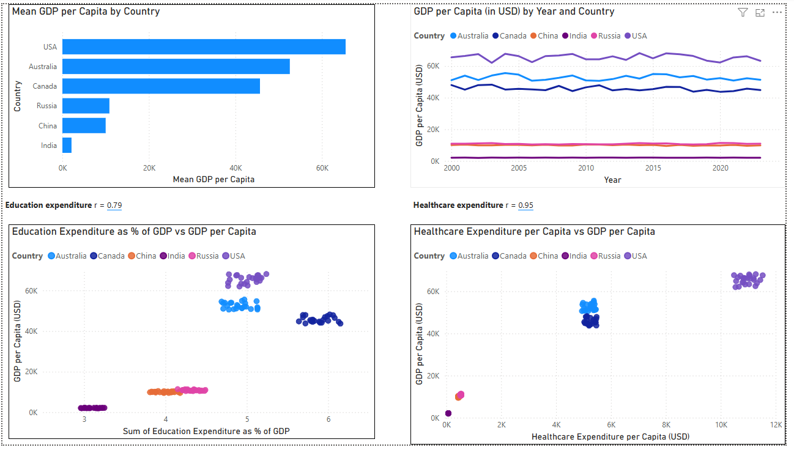
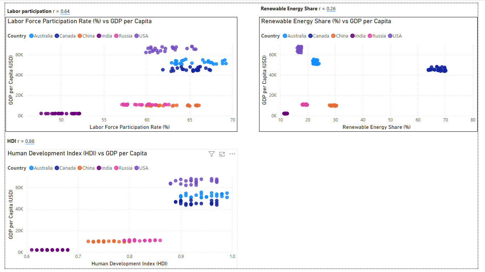

<p align="center">
  
</p>
# Capstone - Global Economic Indicators Analytics 🌍

##### Date: 25 Oct 2026

##### Prepared by: Aaron Aw

- **Dataset Used:** Global Economic Indicators
- **Jupyter Notebook:** [`Capstone_Economics_Analysis.ipynb`](Capstone_Economics_Analysis.ipynb)
- **Power BI Report:** [`Capstone - Economics Analysis.pbix`](<Capstone - Economics Analysis.pbix>)

---

## Project Overview

This project analyses a country-level panel dataset covering **six economies (Australia, Canada, China, India, Russia, USA) from 2000 to 2023**: 144 country-years and 36 economic, social, health, environmental and governance indicators.

It explores which levers (education, healthcare, labor market, renewable energy and development level) are associated with **GDP per Capita**, and then fits a linear regression model to predict it. It is delivered as:

- a **Jupyter / Google Colab notebook** (data cleaning, analysis of five research objectives, predictive model), and
- a **Power BI** report with the key charts and correlations.

---

## Table of Contents

- [Problem Statement](#problem-statement)
- [Research Objectives](#research-objectives)
- [Repository Contents](#repository-contents)
- [Dataset Overview](#dataset-overview)
- [Data Dictionary](#data-dictionary)
- [Data Quality & Cleaning Notes](#data-quality--cleaning-notes)
- [Key Findings](#key-findings)
- [Predictive Model: Linear Regression](#predictive-model-linear-regression)
- [Power BI Dashboard](#power-bi-dashboard)
- [How to Run](#how-to-run)
- [Tools and Resources](#tools-and-resources)
- [Actionable Recommendations](#actionable-recommendations)
- [Limitations](#limitations)
- [Conclusion](#conclusion)
- [Retrospective: Buds, Roses and Thorns](#retrospective-buds-roses-and-thorns)

---

## Problem Statement

**How can education, healthcare, labor participation, and renewable energy be leveraged to increase GDP per capita, while understanding the global economic, social, and environmental patterns that drive differences in development across countries?**

---

## Research Objectives

**1. Education and Literacy Impact on GDP per Capita**
Assess the relationship between Literacy Rate (%) and Education Expenditure as % of GDP against GDP per Capita to determine whether higher education investment and attainment are associated with stronger economic performance.
*Value:* shows whether education is a lever worth funding for income growth.

**2. Healthcare Investment and Outcomes**
Analyze how Healthcare Expenditure per Capita and Doctor-to-Patient Ratio relate to GDP per Capita to identify whether greater healthcare spending and access are associated with stronger economic performance.
*Value:* separates how much money is spent on health from how much access people have.

**3. Labor Market Participation and Economic Output**
Investigate the association between Labor Force Participation Rate (%) and Unemployment Rate (%) and GDP per Capita to determine how workforce engagement relates to income levels across countries.
*Value:* tests whether getting more people into work is enough to raise income per person.

**4. Renewable Energy Adoption, Growth and Sustainability**
Examine how Renewable Energy Share (%) relates to GDP per Capita to establish whether higher renewable energy adoption is associated with stronger or weaker economic performance.
*Value:* checks whether the energy transition carries an economic trade-off or benefit.

**5. Development Level and Quality of Life Patterns**
Examine how HDI and Poverty Rate (%) relate to GDP per Capita across countries to identify which countries are high-performing and which are lagging in development.
*Value:* ranks countries and shows where development gaps are largest.

---

## Repository Contents

| File | Description |
|:-----|:------------|
| `Capstone_Economics_Analysis.ipynb` | Data cleaning, exploratory analysis and regression model |
| `Capstone - Economics Analysis.pbix` | Power BI report |
| `PBI_dashboard1.png` | Dashboard page 1: country benchmark, trend over time, education and healthcare |
| `PBI_dashboard2.png` | Dashboard page 2: labor, renewable energy and HDI |

---

## Dataset Overview

- **File Name:** `Global Economic Data.csv` (raw), `Global_Economic_Data_Cleaned.csv` (output of the notebook)
- **Time Horizon:** 2000 – 2023 (24 years)
- **Countries:** Australia, Canada, China, India, Russia, USA
- **Size:** 144 rows (6 countries × 24 years) and 36 columns in the raw file
- **Target Variable:** `GDP per Capita (in USD)`

---

## Data Dictionary

`Country` is a string, `Year` is an integer and the remaining 34 columns are floats. The columns fall into the groups below.

| Group | Columns | Used In |
|:------|:--------|:--------|
| **Identifiers** | `Country`, `Year` | All objectives, `Country` is one-hot encoded in the model |
| **Economy** | `GDP (in Trillions USD)`, `GDP per Capita (in USD)`, `Inflation Rate (%)` | `GDP per Capita` is the target |
| **Population** | `Population (in Millions)`, `Population Growth Rate (%)`, `Urban Population (%)` | Reference |
| **Health** | `Life Expectancy (Years)`, `Healthcare Expenditure per Capita (USD)`, `Doctor-to-Patient Ratio` | Objective 2 |
| **Education** | `Literacy Rate (%)`, `Education Expenditure as % of GDP` | Objective 1 |
| **Labor** | `Unemployment Rate (%)`, `Labor Force Participation Rate (%)` | Objective 3 |
| **Energy and environment** | `Energy Consumption (TWh)`, `Renewable Energy Share (%)`, `CO2 Emissions (Million Metric Tons)`, `Forest Coverage (%)`, `Agricultural Land (%)` | `Renewable Energy Share` is Objective 4 |
| **Development** | `Human Development Index (HDI)`, `Gender Equality Index`, `Poverty Rate (%)` | Objective 5 |
| **Technology and infrastructure** | `Internet Penetration (%)`, `Smartphone Adoption (%)`, `Number of Airports`, `Road Network Length (in km)`, `Public Transport Usage (%)` | Reference |
| **Defence** | `Military Expenditure (in Billion USD)`, `Number of Active Military Personnel` | Reference |
| **Tourism** | `Number of International Visitors (in Millions)`, `Tourism Revenue (in Billion USD)` | Reference |
| **Governance and society** | `Crime Rate (per 100,000)`, `Corruption Perception Index`, `Freedom of Press Index`, `Voting Participation Rate (%)` | Reference |

---

## Data Quality & Cleaning Notes

The notebook runs the following checks and fixes before any analysis:

| Step | Check or operation | Result on this dataset |
|:-----|:-------------------|:-----------------------|
| 1 | Missing values | 0 missing cells. `dropna()` is still applied as a safeguard and the row count stays at 144 |
| 2 | Duplicate rows | 0 fully duplicated rows |
| 3 | Range checks: every `(%)` column between 0 and 100, `HDI` and `Gender Equality Index` between 0 and 1 (16 columns) | 2 columns failed: `Literacy Rate (%)` had 42 values above 100 (maximum 103.95) and `Gender Equality Index` had 6 values above 1 (maximum 1.03) |
| 4 | Treatment | Both columns capped at their theoretical maximum (100 and 1), then re-checked: 0 violations |
| 5 | Added columns | `Literacy Rate Capped Flag`, `Gender Equality Capped Flag` and `GDPpc Implied (USD)` = `GDP (in Trillions USD) × 1e6 / Population (in Millions)`, a consistency reference for `GDP per Capita`. The cleaned file has 39 columns |

---

## Key Findings

Each indicator is compared with GDP per Capita in two ways:

- **Pooled r** uses all 144 rows together and captures differences *between* countries.
- **Within-country r** removes each country's own average first and captures change *over time* inside each country.

| Objective | Indicator | Pooled r | Within-country r |
|:----------|:----------|:--------:|:----------------:|
| 1. Education | Literacy Rate (%) | 0.56 | 0.04 |
| 1. Education | Education Expenditure as % of GDP | 0.79 | 0.04 |
| 2. Healthcare | Healthcare Expenditure per Capita (USD) | 0.95 | 0.13 |
| 2. Healthcare | Doctor-to-Patient Ratio | 0.40 | 0.08 |
| 3. Labor | Labor Force Participation Rate (%) | 0.64 | 0.16 |
| 3. Labor | Unemployment Rate (%) | -0.37 | 0.04 |
| 4. Renewable Energy | Renewable Energy Share (%) | 0.26 | -0.04 |
| 5. Development | Human Development Index (HDI) | 0.88 | 0.17 |
| 5. Development | Poverty Rate (%) | -0.26 | -0.02 |

### Observations by objective

- **Country benchmark:** the USA (about 65,479 USD) and Australia (about 52,578 USD) lead on mean GDP per Capita over 2000–2023, followed by Canada, Russia and China. India is far behind at about 2,106 USD.
- **Objective 1 – Education:** education spending (0.79) is strongly linked to income between countries, literacy less so (0.56). Within a country, neither moves with GDP per Capita (0.04).
- **Objective 2 – Healthcare:** healthcare spending per capita has the strongest pooled correlation of any indicator (0.95). More doctors per patient does not go with higher GDP per Capita (0.40 pooled, 0.08 within).
- **Objective 3 – Labor:** China's participation is similar to the USA's, but its GDP per Capita is about one-sixth, so more people in work does not by itself mean higher income per person.
- **Objective 4 – Renewable energy:** a weak positive association (0.26) that is not robust within countries (-0.04), so there is no consistent evidence of a link in either direction.
- **Objective 5 – Development:** HDI (0.88) ranks the countries in nearly the same order as GDP per Capita, which is expected as income is a component of HDI. Poverty rate is weak and unstable (-0.26): India has the highest poverty and lowest income, but China has the lowest poverty (about 2%) with a middle-income GDP per Capita.

> **Takeaway:** differences in GDP per Capita are mostly differences *between* countries. Inside a country, GDP per Capita stays roughly level over 2000–2023 and no indicator tracks it closely (every within-country correlation is 0.17 or lower). The correlation heatmap also shows many indicators moving together, so their separate effects are hard to untangle.

> These are associations in a six-country panel, not proof that any lever *causes* higher GDP per Capita.

---

## Predictive Model: Linear Regression

- **Target (y):** `GDP per Capita (in USD)`
- **Features (X):** 8 numeric levers (literacy, education spend, healthcare spend, doctor-to-patient ratio, labor participation, unemployment, renewable share, poverty rate) plus `Country`
- **Excluded:** `HDI` (partly built from income), and GDP, population and implied GDP per capita (the outcome in another form)
- **Preprocessing:** numeric columns standardised with `StandardScaler`, `Country` one-hot encoded with `drop='first'` (Australia is the reference country)
- **Split:** 80/20 random split stratified by country (115 train rows, 29 test rows, `random_state=42`)

| Set | R² | RMSE (USD) |
|:----|:--:|:----------:|
| Train | 0.998 | 1,105 |
| Test | 0.997 | 1,237 |

The very high R² is probably driven mostly by the `Country` terms, since GDP per Capita differs far more between countries than within them (see the within-country correlations above).

---

## Power BI Dashboard

The report shows the country benchmark, GDP per Capita over time by country, and one scatter plot per lever with its correlation.





---

## How to Run

1. Open `Capstone_Economics_Analysis.ipynb` in **Google Colab** (File → Upload notebook).
2. Put `Global Economic Data.csv` in `My Drive/Colab Notebooks/` on your Google Drive. The notebook mounts Drive and reads the file from that folder. If your file is elsewhere, change the path in the data-loading cell.
3. Choose **Runtime → Run all**.
4. The cleaned file is saved to the same Drive folder as `Global_Economic_Data_Cleaned.csv`.

To explore the cleaned data without Colab:

```python
import pandas as pd

# Load the cleaned dataset
df = pd.read_csv('Global_Economic_Data_Cleaned.csv')

# Mean GDP per Capita by country, highest first
bench = df.groupby('Country')['GDP per Capita (in USD)'].mean().sort_values(ascending=False)
print("Mean GDP per Capita by Country:\n", bench.round(0))

# Correlation of one indicator with GDP per Capita
r = df['Healthcare Expenditure per Capita (USD)'].corr(df['GDP per Capita (in USD)'])
print(f"Healthcare spend vs GDP per Capita: r = {r:.2f}")
```

---

## Tools and Resources

- **Python 3** (pandas, numpy, matplotlib, scikit-learn)
- **Google Colab** for the notebook
- **Power BI Desktop** for the dashboard
- **GitHub** for version control

---

## Actionable Recommendations

1. **Treat education and healthcare spending as long-term, structural levers.** They separate rich and poor countries (0.79 and 0.95 pooled) but show no year-to-year payoff inside a country (0.04 and 0.13), so do not expect a short-term jump in GDP per Capita from a one-off budget increase.
2. **Do not rely on workforce participation alone.** China matches the USA on participation with about one-sixth of the income, so pair jobs policy with productivity and skills.
3. **Do not justify renewable energy targets on GDP per Capita grounds.** The data shows no consistent link, so decide on environmental and energy-security grounds.
4. **Be cautious using the regression for decisions.** Its accuracy mostly reflects which country a row belongs to, not the effect of the levers.

---

## Limitations

- **Small sample:** only six countries and 144 rows, so the pooled correlations are driven by a few country clusters.
- **Association, not causation:** the analysis shows correlations only, and many indicators move together.
- **Within-country change is small:** GDP per Capita barely moves over 2000–2023 in any country, which leaves little time variation to explain.
- **Model design:** with `Country` as a feature, the high R² mostly reflects differences between countries. A random split also puts years from the same country in both train and test sets, which makes the test easier than predicting future years or a new country.
- **Capping:** literacy and gender equality values above their maximum were capped rather than investigated at source.

---

## Conclusion

GDP per Capita in this dataset is explained mainly by **which country** an observation belongs to. Healthcare spending, HDI and education spending track income closely across countries, but within a country none of the levers moves with GDP per Capita, and renewable energy and poverty rate show no consistent link. A linear regression with one-hot encoded country predicts GDP per Capita with a test R² of about 0.997, although much of that comes from the country terms.

---

## Retrospective: Buds, Roses and Thorns

#### 🌱 Buds (Opportunities for Growth)

- Add more countries and years so the findings do not rest on six economies.
- Test lagged effects (for example spending in year *t* against GDP per Capita in year *t+3*) and country fixed-effects models.
- Use a time-based train/test split and compare other models (Ridge, Random Forest, Gradient Boosting) with cross-validation.
- Report significance (p-values or confidence intervals) alongside each correlation.
- Create the capped-value flags before capping so they record which values were adjusted.
- Try other outcomes such as `HDI`, `Life Expectancy (Years)` or `Poverty Rate (%)`.

#### 🌹 Roses (What Went Well)

- Ran documented range and consistency checks and kept a flag and a reference column in the cleaned file.
- Separated between-country and within-country correlations, which stopped the pooled results being over-read.
- Left out `HDI`, GDP, population and implied GDP per capita from the model to avoid using the outcome as an input.
- Presented the same results in the notebook and a Power BI dashboard.

#### 🌵 Thorns (Challenges and Limitations)

- Only six countries, so results lean heavily on a few clusters.
- Many indicators are correlated with each other, which makes separate effects hard to isolate.
- Little change over time within each country limits what the model can learn beyond country differences.
